# Karyavahi

**Close a learning case only when children learn more.**

Karyavahi is a case ledger for school education. Each drop in learning becomes a case with an owner and a deadline. Every step of the case has to show proof. The case closes only when the next assessment shows that children learned more. Built for the Tech4Dev **Data to Action** challenge.

| | |
|---|---|
| **Live demo** | <https://karyavahi.onrender.com> (no password; pick an account on the sign-in page) |
| **Demo video (3 min)** | *YouTube link is added here before submission* |
| **Run it locally** | [Setup](#run-it-locally), about 5 minutes |
| **How AI is used** | [AI services and models](#ai-services-and-models), [How Claude is kept honest](#how-claude-is-kept-honest) |

> **Demo data.** The schools, enrolment, teacher counts and locations are real public data (UDISE+ via India Data Portal). School names and UDISE codes are withheld, and map pins are moved a few hundred metres. The learning results are simulated and calibrated to PRS 2024. The people, cases and outcomes are fictional. These are not government statistics.

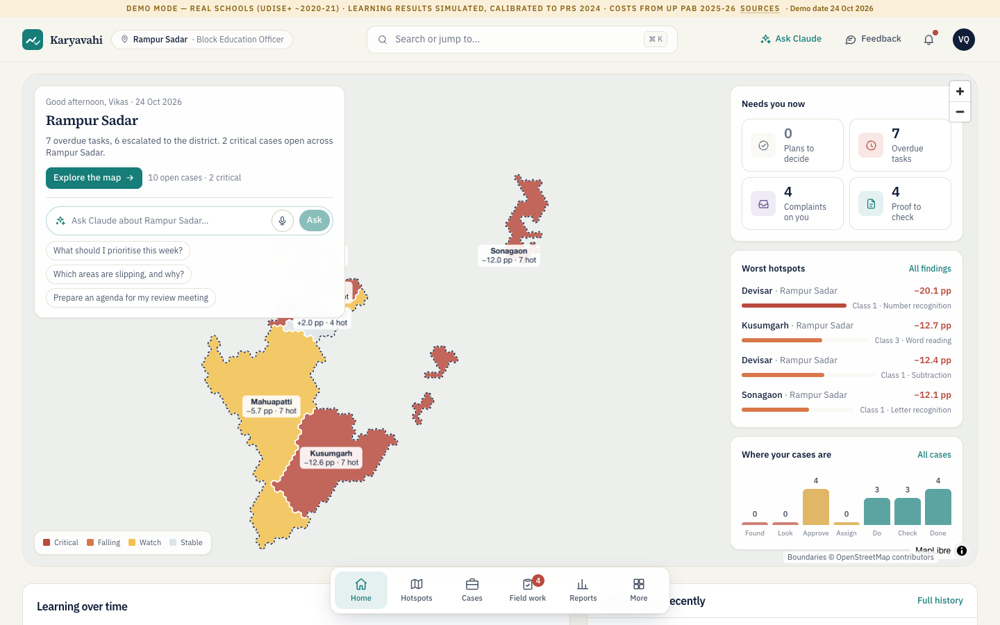

---

## The problem

A block officer opens a dashboard and sees a red cell: Class 3 subtraction fell 18 points. Then nothing happens. Today's systems stop at the alert. Nobody owns the drop, there is no deadline and no proof of work, and nobody checks whether the children learned more.

## What Karyavahi does

Each learning drop becomes a **case** that goes through eight stages:

**Flag → Diagnose → Plan → Approve → Assign → Act → Verify → Close (only on a measured gain)**

- **Flag.** A rule-based detector compares each cluster with its own district over two assessment rounds. It opens a case only when the drop is large and statistically clear, with a two-proportion z-test.
- **Diagnose.** It names the schools driving the drop and the conditions behind it, such as unfilled teacher posts or months without a cluster visit. Each row links to the record it came from.
- **Plan and approve.** The officer chooses an intervention from an evidence library with real costs (UP PAB 2025-26). **Someone other than the officer approves the plan.** Approval locks the comparison schools and the success threshold before anyone sees the result.
- **Act.** Tasks go to headmasters and field staff, each with an owner, a deadline and the proof required. They can work in the app (in Hindi, offline, by voice) or **on WhatsApp**.
- **Verify.** Someone other than the person who did the work checks the proof. When the next round of results is imported, the outcome check compares the plan's schools with similar schools. If there was no gain, the case **reopens**.
- **Report.** The Action Taken Report and the review pack are built from the ledger, so a report cannot claim more than the records show.

Every change is written to a **hash-chained audit trail**, and editing any row breaks the chain.

## Screenshots

| | |
|---|---|
| 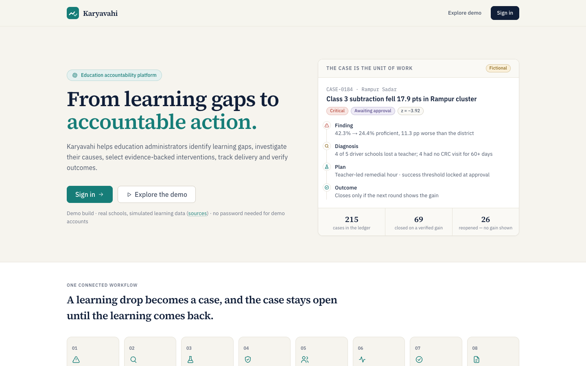 **Landing page.** The case is the unit of work. | 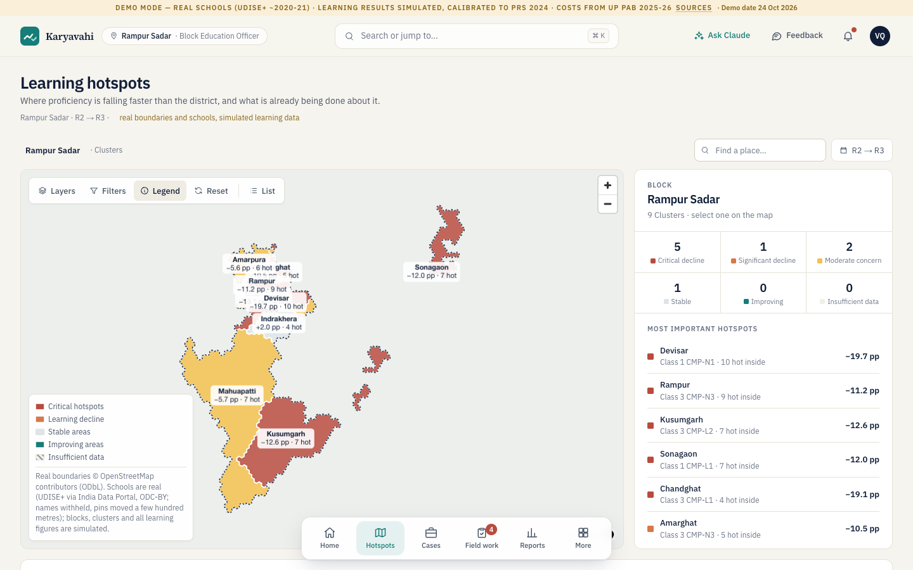 **Learning hotspots.** Real Uttar Pradesh boundaries, drilling down from district to school. |
| 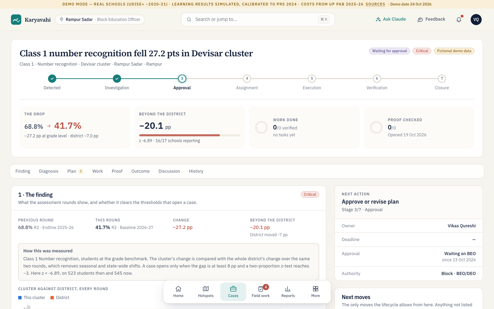 **A case.** The drop, how it was measured, the lifecycle and the next action. | 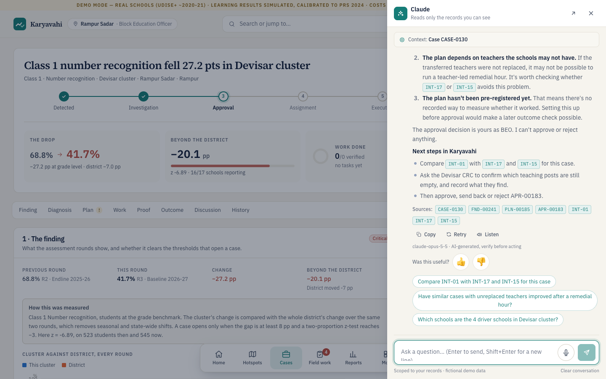 **Claude explains the case** in plain words. Every record it used is cited, and it says the decision is the officer's. |
| 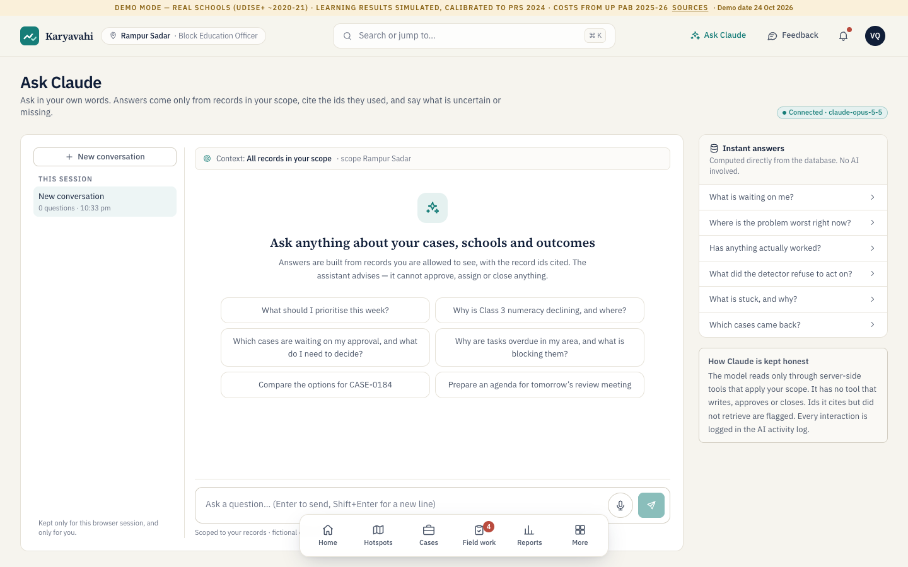 **Ask Claude.** Answers come only from records the user is allowed to see. | 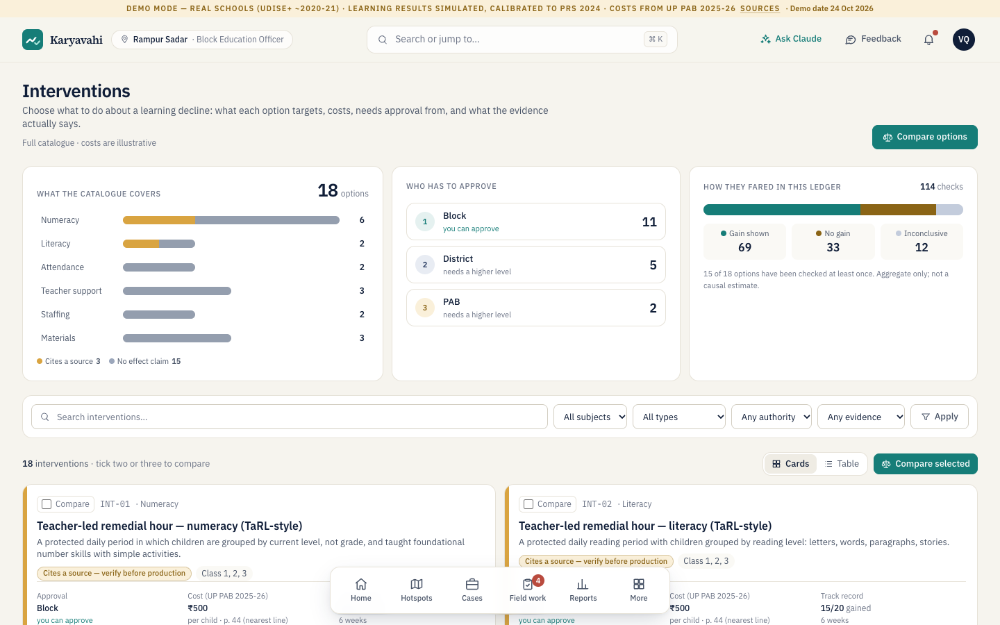 **Evidence library.** Costs, who approves, and how each option did in this ledger. |
| 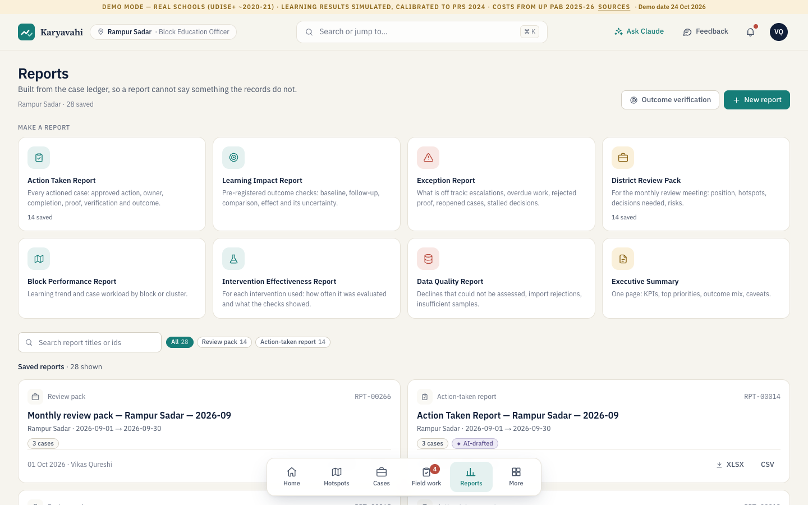 **Reports** built from the case ledger. | |

**For headmasters and field staff, on a phone, in Hindi:**

<p>
  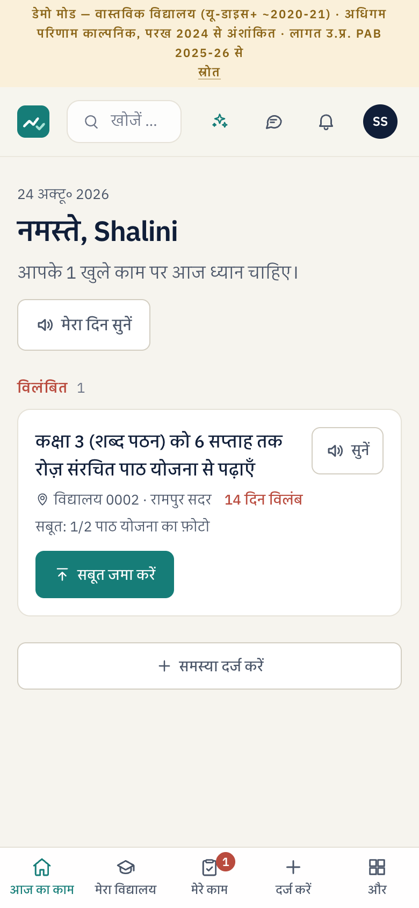
  &nbsp;&nbsp;
  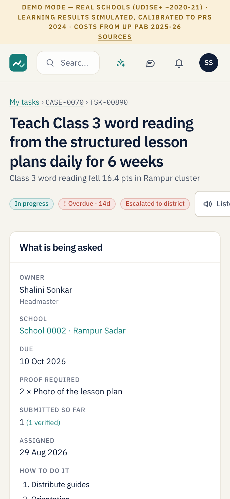
</p>

*Left: "My day" in Hindi. **मेरा दिन सुनें** ("listen to my day") reads it aloud. Right: a task, with its owner, deadline and the proof it needs.*

## Key features, and how they make it easy to use

**For officers (block, district, state)**
- **Command centre** with the officer's own area on a real map and what needs them today. `⌘K` / `Ctrl K` searches or jumps to anything.
- **Claude co-pilot everywhere.** It explains a finding, suggests a plan from the evidence library, summarises a discussion, explains an outcome and drafts the report narrative. It answers questions in plain words, with citations.
- **Approval in one tap**, from a different person than the one who proposed the plan.
- **Data import with a live detection run.** Upload the next round's CSV. Bad rows are refused, each with a reason, and new cases open on their own.
- **Read-only API** for state dashboards (`/developers`), with keys, scopes and rate limits.

**For headmasters and field staff**
- **Hindi first.** Every screen is in Hindi or English; the account remembers which.
- **Listen and speak.** Hear the day read aloud instead of reading it, and dictate a note instead of typing.
- **Works without signal.** Proof is saved on the phone and sent when the network returns, with the location checked against the school.
- **WhatsApp, with no app to install.** Tasks arrive as messages. Reply `1` for "seen" or `2` for "started", and send a photo as proof. Built on Meta's Cloud API and tested end to end against a mocked Meta (111 checks). The live test number is connected and receives messages; delivery of replies to test phones is being finished for the next round.

**Trust**
- Code computes every number; Claude only narrates (see below).
- Every role sees only its own area. A refused page explains why.
- The audit trail is tamper-evident. A data-quality page shows what could not be assessed and why.

---

## AI services and models

Karyavahi calls **one AI service: Anthropic's Claude API.** There are no other AI models, embeddings or AI APIs in the codebase.

| Service | Model | Used for | Key needed | Where it is called |
|---|---|---|---|---|
| **Anthropic Claude API** (`@anthropic-ai/sdk`) | **`claude-opus-5-5`** by default (`KARYAVAHI_AI_MODEL` changes it) | 1. **Ask Claude** chat: a tool-use loop over 19 read-only, scope-checked tools (cases, hotspots, overdue tasks, evidence library, outcomes and more), streamed with cited record ids.<br>2. **Co-pilot drafts** on pages: explain a finding, suggest a plan, summarise a discussion, explain an outcome, write a report narrative. Structured JSON output.<br>3. **Dashboard briefing**: one structured call over the computed summary, never raw rows. | `ANTHROPIC_API_KEY`, **server side only**, never sent to the browser | `app/src/lib/ai/client.ts` (client and activity log), `chat.ts`, `copilot.ts`, `briefing.ts`, `tools.ts`, `config.ts`; routes `app/src/app/api/ai/{chat,copilot,briefing}` |

Claude API features used: adaptive thinking, structured outputs (`output_config.format` JSON schema), prompt caching, tool use, and the server-side refusal fallback (`server-side-fallback-2026-07-01`; turn it off with `KARYAVAHI_AI_FALLBACKS=off`).

**Without a key** the app runs fully, and the AI panels say "not connected". Nothing pretends to be a model.

### Other external services (not AI)

| Service | Used for | Key needed |
|---|---|---|
| Meta **WhatsApp Cloud API** (Graph API) | Sending tasks to test phones and receiving replies and photos (`app/src/lib/whatsapp/`) | `WHATSAPP_*` settings (below). Optional; without them, messages are only simulated in the admin outbox |
| **Google Maps JavaScript API** | Optional base map | `NEXT_PUBLIC_GOOGLE_MAPS_API_KEY`, optional. Without it, the app uses **MapLibre** with OpenStreetMap boundaries and needs no key |
| Browser **Web Speech API** | "Listen" (speech synthesis) and "speak a note" (speech recognition) | None. It runs in the user's browser; in Chrome, speech recognition is processed by the browser vendor's speech service |

### How Claude is kept honest

- **Claude cannot change anything.** It has no tool that approves, assigns, verifies, closes or reopens. Every decision is a person's, and goes into the audit trail.
- **Scoped reads only.** Claude never sees the database, only the results of tools that apply the signed-in user's scope. Page context sent from the browser is checked again on the server.
- **An auditor pass on every figure** (`app/src/lib/ai/audit-numbers.ts`). Every number Claude writes is looked up in the data it was given. If a figure is not there, the draft is sent back once. If it is still there, the figure is marked "unsupported" on screen.
- **Always cited.** Answers list the record ids they were built from, labelled "AI-generated, verify before acting".
- **Logged.** Each call records the model, tools used, cited ids, token counts and a short excerpt of the question, not the whole conversation (the admin **AI activity** page).
- **Rate limited and same-site only:** 12 drafts per 5 minutes per user. Cross-site requests are refused.

---

## Run it locally

**You need:** Node.js **22.5 or newer** (it uses the built-in `node:sqlite`; Node 24 is what the hosted demo runs) and npm. Nothing else to install: the database ships prebuilt.

```bash
git clone <this repository>
cd karyavahi/app
npm install
cp .env.example .env.local      # then add your own keys (all optional; see below)
npm run dev
```

Open <http://localhost:3000> and pick an account on the sign-in page. There are no passwords. Good places to start:

| Account | Role | What to try |
|---|---|---|
| `beo.blk-01@demo.karyavahi.test` | Block officer, Rampur Sadar (prefers Hindi; the header button switches language) | Command centre, then **CASE-0184**, then **Ask Claude** |
| `deo.rmp@demo.karyavahi.test` | District officer, Rampur | Approve a plan the block officer submitted |
| `hm.sch-00002@demo.karyavahi.test` | Headmaster (use a phone-sized window) | **My day**: listen, hand in a photo as proof, try it offline |
| `state.lead@demo.karyavahi.test` | State team | The Uttar Pradesh hotspot map, drilling down from district to school |
| `admin@demo.karyavahi.test` | Demo admin | Move the demo clock, reset the demo, WhatsApp outbox, AI activity log |

For a production build, run `npm run build && npm start`. To reset the demo data, run `npm run db:init -- --force` with the server stopped.

A longer walkthrough, including importing the November round and watching new cases open, is in [START-HERE.md](START-HERE.md). Every module is explained in [app/README.md](app/README.md).

### Environment variables

[`app/.env.example`](app/.env.example) is the sample file. Copy it to `app/.env.local`, which git ignores. **Every value is optional.** With none set, the app runs with AI off, the MapLibre map and simulated WhatsApp.

| Variable | What it does | Default |
|---|---|---|
| `ANTHROPIC_API_KEY` | Turns on every Claude feature. Server only. | *(AI off)* |
| `KARYAVAHI_AI_MODEL` | The Claude model id | `claude-opus-5-5` |
| `KARYAVAHI_AI_EFFORT` | `low`, `medium` or `high` | `medium` |
| `KARYAVAHI_AI_FALLBACKS` | `off` turns off the server-side refusal fallback | on |
| `NEXT_PUBLIC_GOOGLE_MAPS_API_KEY` | Google base map. A browser key; lock it to your site address. | *(MapLibre)* |
| `WHATSAPP_ACCESS_TOKEN` | Meta system-user token with `whatsapp_business_messaging` | *(simulated)* |
| `WHATSAPP_PHONE_NUMBER_ID` | The WhatsApp number's id in Meta's API Setup | |
| `WHATSAPP_APP_SECRET` | Checks the `X-Hub-Signature-256` on incoming webhooks | |
| `WHATSAPP_VERIFY_TOKEN` | Any string, also typed into Meta's webhook settings | |
| `WHATSAPP_TEST_RECIPIENTS` | `account-email=+91…` pairs, comma-separated. Only these numbers get real messages. | |
| `WHATSAPP_BUSINESS_ACCOUNT_ID` | Pre-fills the "connect the webhook" form on the admin outbox | |
| `WHATSAPP_GRAPH_VERSION` | Graph API version | `v25.0` |
| `KV_NIGHTLY_RESET` | `on` restores the seed at 03:00 India time (hosted demo) | off |
| `KV_SCHEDULER` | `off` stops the reminder and escalation timer | on |

### Tests

```bash
cd app
npm run typecheck
npm run verify          # 20 database test suites, over 1,000 checks (stop the server first)
npm run verify:full     # + production build, every route as every role in both languages, the browser walkthrough
```

Other suites, each run against a running server: `node scripts/e2e-v2.cjs` (add `--ai` for live Claude checks), `node scripts/hindi-check.mjs`, `node scripts/voice-e2e.cjs` and `node scripts/offline-e2e.cjs`. The browser tests use the installed Google Chrome through `playwright-core`. `verify.sh` needs bash (Git Bash or WSL on Windows).

### Deploying

[`render.yaml`](render.yaml) is the blueprint the live demo uses: Render, Node 24, a build that pre-warms the database, a health check at `/api/health` and a nightly reset. Secrets are set in Render's dashboard and never in the file (`sync: false`).

---

## How it is built

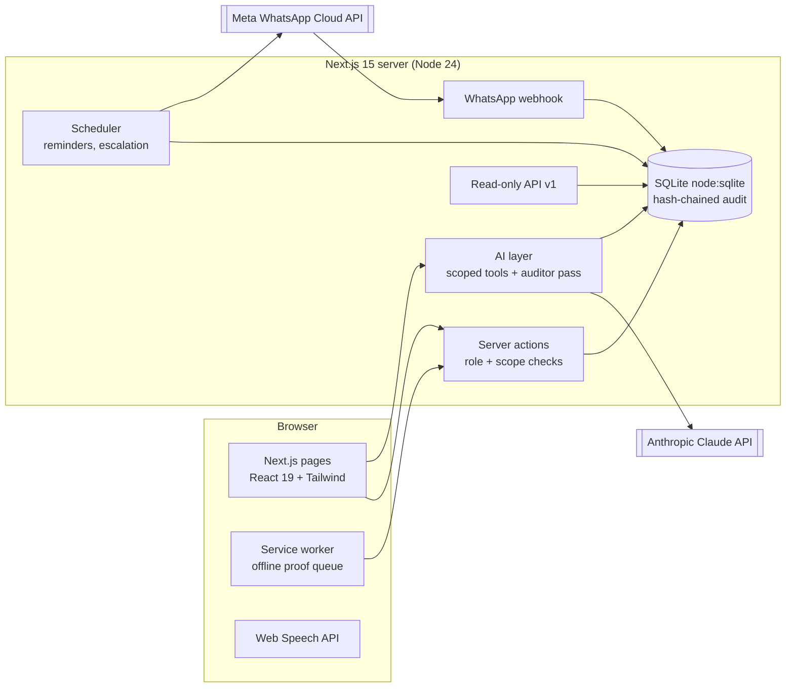

| Folder | What is in it |
|---|---|
| `src/domain/` | The rules, shared by the seed generator and the app: detection, outcome check, lifecycle, permissions |
| `src/lib/` | Seeded randomness, India-time dates, statistics helpers |
| `app/src/app/` | Pages and API routes (Next.js App Router) |
| `app/src/lib/` | Server logic: cases, plans, tasks, proof, audit chain, import, scheduler, `ai/`, `whatsapp/` |
| `app/src/components/` | UI components: map, charts, Claude panels, voice, offline support |
| `app/data/real/` | The two small committed files of real public data (schools and district figures) |
| `app/.data/karyavahi.pristine.db` | The prebuilt demo database |
| `app/scripts/` | Tests, the seed and data builders, screenshot helpers |
| `docs/` | Roadmap, user-testing kit, these screenshots |

## Real public data, and credits

| Source | Used for |
|---|---|
| **UDISE+** (Ministry of Education), through India Data Portal | Schools, enrolment, teachers and locations in Rampur, Lucknow and Varanasi. Names and codes are withheld. |
| **PRS 2024** (Parakh Rashtriya Sarvekshan, NCERT) | Calibrating the simulated Class 3 results to each district |
| **ASER 2024** | State reading and arithmetic context |
| **NFHS-5** | District context |
| **UP PAB 2025-26 minutes** (Samagra Shiksha) | Intervention unit costs, with page references |
| **LGD** (Local Government Directory) | District and block codes |
| **PGI-D** (Performance Grading Index for Districts, Ministry of Education), 2022-23 to 2025-26 | Each district's overall and Outcomes grade, and how it has changed over the years |
| **Census 2011** Primary Census Abstract, through India Data Portal | District literacy, female literacy, SC/ST share and rural share, shown beside the UP figure |
| **NITI Aayog Aspirational Blocks Programme** (March 2026) | Saidnagar, Rampur's aspirational block, with its 11 education indicators beside the UP median |
| **PM SHRI** school list (Ministry of Education) | The 37 demo schools whose real counterpart is a PM SHRI school carry a PM SHRI badge |
| **OpenStreetMap** contributors (ODbL) | Boundaries |

The district figures appear on the hotspot map and district pages as **context, not cause**.

The full list with licences is on the **/sources** page of the app. How the data is rebuilt and checked is explained in [app/README.md, "Real public data"](app/README.md).

## Privacy, secrets and personal data

- **No secrets in the repository.** All keys are read from environment variables. `.env*.local` and `.env` are git-ignored; only the key-free `app/.env.example` is committed. We scanned the full history of every branch for API keys and tokens (Anthropic, Meta, Google, GitHub) and found none.
- **No personal data of real users.** Every account, person, case and outcome is fictional, on the reserved `demo.karyavahi.test` domain. There are no student-level records. Real schools appear only as "School 0412 · Rampur Sadar", never by name or UDISE code, with pins moved 300–700 m. A test (`npm run test:realdata`) scans every page and API answer for leaks.
- **WhatsApp test numbers** live only in the server's environment, never in the database or the repo. Message ids are stored as one-way hashes, and numbers are masked on screen.
- The hosted demo's privacy notice is at [/privacy](https://karyavahi.onrender.com/privacy).

## What's next

A pilot in one district with the state's own assessment data, then state-wide. See [docs/ROADMAP.md](docs/ROADMAP.md) (also at [/roadmap](https://karyavahi.onrender.com/roadmap)): phases, integrations, the cost of running Claude (about ₹5 per draft), risks and pilot metrics.

## Known limits

- Learning results are simulated. Nothing is connected to a live UDISE+, NAS, state VSK or IVR.
- WhatsApp uses Meta's test number, so only phone numbers registered as testers can take part. Incoming messages reach the live demo; replies to the phone are not yet delivering reliably, so the WhatsApp flow is shown in the video as a re-created chat.
- The free Render plan sleeps when idle, so the first visit after a pause can take about a minute.

## Submission

This repository is the source code for our Tech4Dev Data to Action submission. The evaluation runs on its state at the submission deadline; we make no commits after it.
